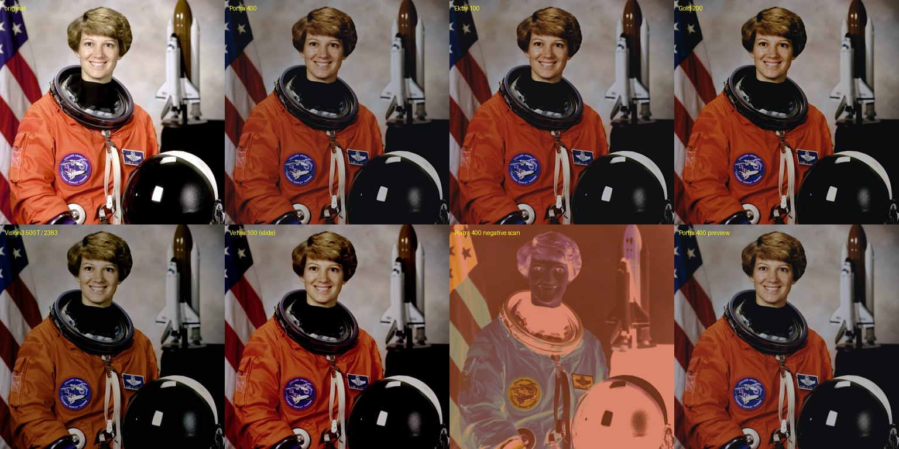

# ComfyUI-Spektrafilm

Spectral simulation of analog film for ComfyUI: your image is exposed onto a virtual negative, printed through a color enlarger onto photographic paper, and scanned. Film stocks, paper, couplers, grain, halation and the enlarger filters all come from manufacturer data sheets.

**Film modeling powered by [spektrafilm](https://github.com/andreavolpato/spektrafilm)** by Andrea Volpato. This pack is a ComfyUI front end to its runtime; all the color science is his. If you like the results, star the upstream repo or [buy him a coffee](https://buymeacoffee.com/andreavolpato).



*Top: original, Portra 400, Ektar 100, Gold 200. Bottom: Vision3 500T on 2383, Velvia 100 (slide), Portra 400 negative scan, Portra 400 preview mode. Test photo: NASA, public domain.*

## Install

Install with ComfyUI Manager, or clone into `ComfyUI/custom_nodes` and install the requirements:

```
cd ComfyUI/custom_nodes
git clone https://github.com/jtydhr88/ComfyUI-Spektrafilm
pip install -r ComfyUI-Spektrafilm/requirements.txt
```

All dependencies ship wheels for Windows, Linux and macOS. Everything runs on the CPU (numpy, scipy and numba); no models and no VRAM are needed.

## Nodes

**Spektrafilm Film Simulation** takes an IMAGE and returns the scanned print (or the scanned film). The main settings are on the node:

- film stock and print paper (20 films, 8 papers)
- output: `print`, `film scan`, or `auto` (scans slide film directly, prints negatives)
- seed for grain and print glare; frame *i* of a batch uses seed + *i*, so video frames get moving grain
- preview: skips grain and blurs for a fast look at color and exposure
- camera auto exposure and exposure compensation, print exposure, enlarger Y/M filter shifts

**Spektrafilm Preview** goes after the simulation node. It shows the result of each run, and between runs it is a live preview (run once first, so it has an input image). Every change on the simulation node or on the params nodes chained into it updates the preview in about 0.2 s without queueing the workflow: the backend bakes the per-pixel part of the simulation into a 33³ 3D LUT and the browser applies it to the input image with WebGL. Grain, halation and blurs are spatial and not in the LUT; turn on `grain & blur` to render them on the backend instead (640 px, slower). The live preview is frontend-only: it is not saved in the workflow and not sent in API prompts.

Every other parameter of the spektrafilm GUI is on a params node. Chain any of them into the `params` input:

| Node | Controls |
|---|---|
| Spektrafilm Camera | film format, lens blur, metering method |
| Spektrafilm Camera Diffusion Filter | Pro-Mist / Black Pro-Mist / Glimmerglass / CineBloom on the lens |
| Spektrafilm Halation | in-emulsion scatter, halation, highlight boost |
| Spektrafilm DIR Couplers | coupler inhibition: saturation, contrast, local sharpness |
| Spektrafilm Grain | grain size, uniformity, sublayers, dye clouds |
| Spektrafilm Film Tune | film contrast, CMY channel swaps |
| Spektrafilm Enlarger Diffusion Filter | diffusion filter on the enlarger lens |
| Spektrafilm Preflash | paper preflash to hold highlights |
| Spektrafilm Print Chemistry | print curve morphing, developer exhaustion |
| Spektrafilm Print Glare | surface glare of the print |
| Spektrafilm Scanner | scanner blur, unsharp mask, black/white points |
| Spektrafilm Crop & Upscale | crop or upscale before simulating, to see grain at full scale |
| Spektrafilm Spectral Upsampling | RGB to spectrum method, enlarger/scanner LUTs |
| Spektrafilm Color Space | input/output color space and transfer function (default sRGB in and out, right for normal ComfyUI images) |
| Spektrafilm Input / Output Gamut Compress | gamut compression on the way in and out |

spektrafilm tunes coupler and halation strength per stock; those fields only apply when `override stock preset` is on.

**Spektrafilm Load RAW** demosaics a camera RAW (rawpy / LibRaw) with as-shot, daylight, tungsten or custom white balance and optional lensfun lens correction. Float values above 1 are kept, so highlights survive into the simulation. For wide-gamut input set the same color space (e.g. ProPhoto RGB, no transfer function) here and on a Spektrafilm Color Space node.

**Spektrafilm Load Image (16/32-bit)** loads EXR, 16/32-bit TIFF or 16-bit PNG at full precision (OpenImageIO).

**Spektrafilm Save Image (16/32-bit)** writes 16-bit TIFF, float TIFF/EXR, PNG or JPEG with an embedded ICC profile and EXIF color space tags, converting the color space if needed.

Both loaders have an upload button. Example workflows are in [`example_workflows`](example_workflows) and show up in ComfyUI's template browser.

## Tips

- Auto exposure meters the scene to mid-grey, like a real camera. Turn it off for night or high-key shots you want to keep as they are.
- Grain and halation are physical: their size depends on the film format and the image resolution. Use Crop & Upscale to inspect grain at full scale.
- A 12 MP image takes about a minute on 8 CPU threads; preview mode is about twice as fast.

## How it is built

`vendor/spektrafilm` is the upstream runtime, copied unchanged except for one patch in [`patches`](patches): grain and print glare draw from numpy's seeded random state, so a seed gives the same image every time (upstream glare used unseeded parallel numba random numbers). The node widgets are generated from the upstream GUI's parameter manifest (`vendor/spektrafilm_gui/param_manifest.py`), so ranges and tooltips match the spektrafilm GUI.

To update the vendored copy: `python scripts/sync_spektrafilm.py <path to a spektrafilm clone>`. The upstream commit is recorded in `vendor/UPSTREAM`.

The live preview runs in `live_preview.py`. It rebuilds the parameters by calling the params nodes' own `execute`, so it uses exactly the settings a real run would. Each run caches a downscaled copy of the simulation node's input, keyed by workflow id and node id. `POST /spektrafilm/live_lut` bakes the LUT (auto exposure measured on that input, spatial and random effects off; mean difference to the per-pixel simulation about 0.0002 on photos), `GET /spektrafilm/live_input` sends the input as float16, and `POST /spektrafilm/live_preview` renders the full 640 px preview. The frontend is Vue + TypeScript in `src/`: a Pinia store keeps one entry per Preview node and, on every change, walks from the Preview node to its simulation node and up the `params` chain; `src/lutRenderer.ts` is the WebGL2 renderer. The built bundle `web/js/main.js` is committed; rebuild it with `npm install && npm run build`.

Tests: `pytest tests` from the ComfyUI Python environment.

## License

GPL-3.0, like spektrafilm (see [LICENSE](LICENSE)). The film profiles are CC BY-SA 4.0. The spektrafilm LUTs are under the custom license in [SPEKTRAFILM_LICENSE.txt](SPEKTRAFILM_LICENSE.txt) (commercial use and free sharing allowed, no resale).
