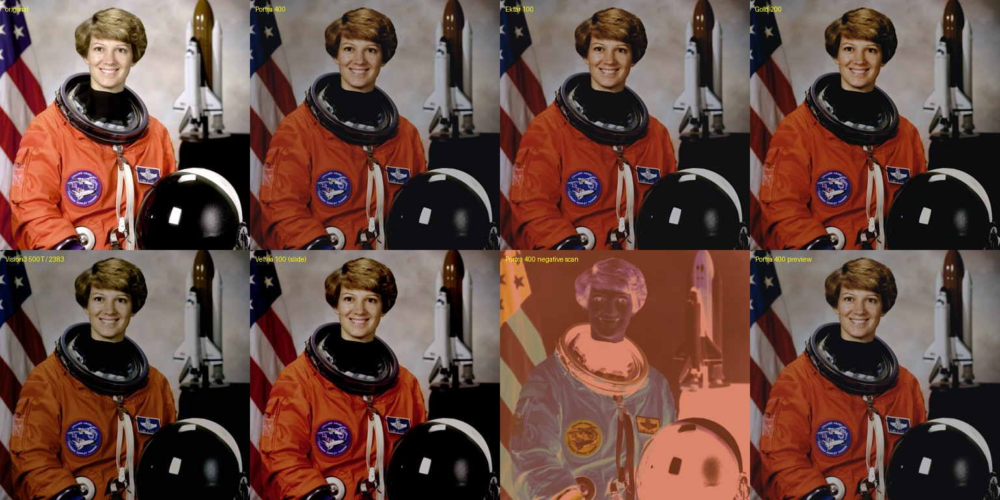

# ComfyUI-Spektrafilm

[English](README.md) | 中文

ComfyUI 上的胶片光谱模拟：把图像曝光到虚拟负片上，通过彩色放大机印到相纸上，再扫描出来。胶片、相纸、成色剂、颗粒、晕光和放大机滤镜的数据全部来自厂商的技术资料。

**胶片建模由 [spektrafilm](https://github.com/andreavolpato/spektrafilm) 提供**，作者 Andrea Volpato。本节点包只是它运行时的 ComfyUI 前端，所有色彩科学都是他的工作。喜欢效果的话，请给上游仓库点个 star，或者[请他喝杯咖啡](https://buymeacoffee.com/andreavolpato)。



*上排：原图、Portra 400、Ektar 100、Gold 200。下排：Vision3 500T 印 2383、Velvia 100（反转片）、Portra 400 负片扫描、Portra 400 预览模式。测试照片：NASA，公有领域。*

## 安装

用 ComfyUI Manager 安装，或者克隆到 `ComfyUI/custom_nodes` 后安装依赖：

```
cd ComfyUI/custom_nodes
git clone https://github.com/jtydhr88/ComfyUI-Spektrafilm
pip install -r ComfyUI-Spektrafilm/requirements.txt
```

所有依赖在 Windows、Linux、macOS 上都有现成的 wheel。全部在 CPU 上运行（numpy、scipy、numba），不需要模型，也不占显存。

## 节点

**Spektrafilm Film Simulation** 输入一张 IMAGE，输出扫描后的照片（或扫描后的胶片）。主要设置都在这个节点上：

- 胶片和相纸（20 种胶片、8 种相纸）
- output：`print`（冲印）、`film scan`（直接扫描胶片），或 `auto`（反转片直接扫描，负片冲印）
- seed：颗粒和相纸眩光的随机种子。批量里第 *i* 帧用 seed + *i*，所以视频帧的颗粒会动
- preview：跳过颗粒和各种模糊，快速看颜色和曝光
- 相机自动曝光和曝光补偿、冲印曝光、放大机 Y/M 滤镜偏移

**Spektrafilm Preview** 接在模拟节点后面。每次运行后显示结果；两次运行之间它是实时预览（需要先运行一次，才有输入图）。改模拟节点或接在它上面的参数节点的任何值，约 0.2 秒内预览就会更新，不用排队运行：后端把模拟中逐像素的部分烘成一个 33³ 的 3D LUT，浏览器用 WebGL 把它套到输入图上。颗粒、晕光和各种模糊是空间效果，LUT 表达不了；打开 `grain & blur`（颗粒和模糊）开关，就改由后端完整渲染（640px，较慢）。实时预览只在前端：不会存进工作流，也不会出现在 API prompt 里。

spektrafilm GUI 里的其他参数都在参数节点上，任意串联后接到模拟节点的 `params` 输入：

| 节点 | 控制内容 |
|---|---|
| Spektrafilm Camera | 画幅、镜头模糊、测光方式 |
| Spektrafilm Camera Diffusion Filter | 镜头上的柔焦滤镜：Pro-Mist / Black Pro-Mist / Glimmerglass / CineBloom |
| Spektrafilm Halation | 乳剂内散射、晕光、高光增强 |
| Spektrafilm DIR Couplers | DIR 成色剂抑制：饱和度、反差、局部锐度 |
| Spektrafilm Grain | 颗粒大小、均匀度、子层、染料云 |
| Spektrafilm Film Tune | 胶片反差、CMY 通道互换 |
| Spektrafilm Enlarger Diffusion Filter | 放大机镜头上的柔焦滤镜 |
| Spektrafilm Preflash | 相纸预曝光，保留高光层次 |
| Spektrafilm Print Chemistry | 相纸曲线变形、显影液疲劳 |
| Spektrafilm Print Glare | 相纸表面眩光 |
| Spektrafilm Scanner | 扫描仪模糊、USM 锐化、黑白点 |
| Spektrafilm Crop & Upscale | 模拟前裁切或放大，用来看清颗粒 |
| Spektrafilm Spectral Upsampling | RGB 转光谱的方法、放大机/扫描仪 LUT |
| Spektrafilm Color Space | 输入/输出色彩空间和传递函数（默认 sRGB 进 sRGB 出，适合普通 ComfyUI 图像） |
| Spektrafilm Input / Output Gamut Compress | 输入和输出时的色域压缩 |

spektrafilm 会按胶片自动设定成色剂和晕光强度；这几个字段只有打开 `override stock preset`（覆盖胶片预设）后才生效。

**Spektrafilm Load RAW** 用 rawpy / LibRaw 解相机 RAW，白平衡可选机内、日光、钨丝灯或自定义，可选 lensfun 镜头校正。超过 1 的浮点值会保留，高光可以完整进入模拟。宽色域输入时，在这里和 Spektrafilm Color Space 节点上设成同一个色彩空间（例如 ProPhoto RGB，不加传递函数）。

**Spektrafilm Load Image (16/32-bit)** 用 OpenImageIO 按原始精度读取 EXR、16/32 位 TIFF 或 16 位 PNG。

**Spektrafilm Save Image (16/32-bit)** 保存为 16 位 TIFF、浮点 TIFF/EXR、PNG 或 JPEG，嵌入 ICC 配置文件和 EXIF 色彩空间标签，需要时转换色彩空间。

两个加载节点都有上传按钮。示例工作流在 [`example_workflows`](example_workflows) 里，会出现在 ComfyUI 的模板列表中。

## 使用提示

- 自动曝光会像真相机一样把画面测成中灰。夜景或高调照片想保持原样时，把它关掉。
- 颗粒和晕光是按物理尺寸算的，大小取决于画幅和图像分辨率。想看清颗粒用 Crop & Upscale。
- 1200 万像素的图在 8 个 CPU 线程上大约要一分钟；预览模式大约快一倍。

## 实现说明

`vendor/spektrafilm` 是上游运行时，原样复制，只有 [`patches`](patches) 里的一个补丁：颗粒和相纸眩光改用 numpy 带种子的随机状态，同一个 seed 每次出图都一样（上游的眩光用的是没有种子的并行 numba 随机数）。节点控件由上游 GUI 的参数清单（`vendor/spektrafilm_gui/param_manifest.py`）生成，范围和提示与 spektrafilm GUI 一致。

更新 vendor 副本：`python scripts/sync_spektrafilm.py <spektrafilm 克隆路径>`。上游 commit 记录在 `vendor/UPSTREAM`。

实时预览在 `live_preview.py` 里。它调用各参数节点自己的 `execute` 重建参数，所以用的设置和真实运行完全一样。每次运行会缓存一份模拟节点输入的缩小副本，按工作流 id 和节点 id 区分。`POST /spektrafilm/live_lut` 烘 LUT（自动曝光按这份输入测，空间和随机效果关闭；在照片上与逐像素模拟的平均差约 0.0002），`GET /spektrafilm/live_input` 以 float16 下发输入图，`POST /spektrafilm/live_preview` 渲染完整的 640px 预览。前端是 `src/` 里的 Vue + TypeScript：一个 Pinia store 为每个 Preview 节点保存一条记录，每次有改动就从 Preview 节点找到它的模拟节点，再沿 `params` 链往上收集参数；`src/lutRenderer.ts` 是 WebGL2 渲染器。打包好的 `web/js/main.js` 已提交；重新打包用 `npm install && npm run build`。

测试：在 ComfyUI 的 Python 环境里运行 `pytest tests`。

## 许可

GPL-3.0，与 spektrafilm 相同（见 [LICENSE](LICENSE)）。胶片数据采用 CC BY-SA 4.0。spektrafilm 的 LUT 使用 [SPEKTRAFILM_LICENSE.txt](SPEKTRAFILM_LICENSE.txt) 中的自定义许可（允许商用和免费分享，禁止转售）。
